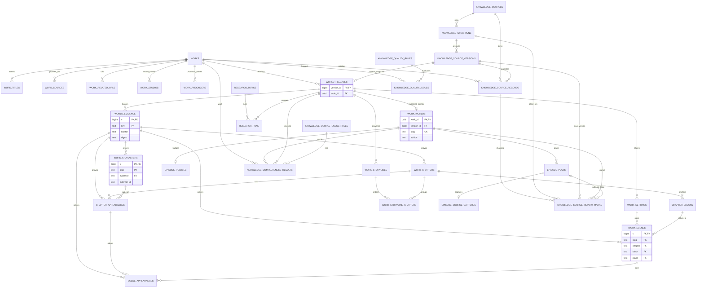
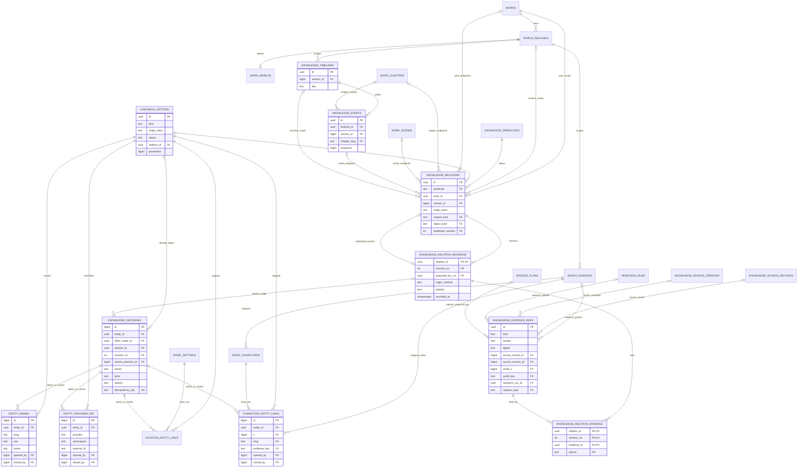

# 知识库实体身份、版本化关系与来源证据

评审稿 · 2026-11-24 · Folio 时光。基线为已同步的 `origin/main`（`fe0be3d165059b3e1ce0c58edb6554f7229f4351`），最新迁移 `065.sql`。建议按角色试点建设 Canonical Entity Registry，先验证跨作品与跨修订身份的运营价值。

## 1. 当前架构审计

本地与远端差异为 `0 0`。`init.sql` 的 `065.sql` 和账本生成范围 `1–65` 与 Go 迁移注册一致。`049.sql` 在 Go 中单独实现。隔离 PostgreSQL 17.12 加载完整 SQL 基线后，账本有 65 条，最大版本为 `065.sql`。系统目录确认下述主外键，空库公开世界、关联作品均为 0。第 11 章记录运行核验。[SQL 末段](../database/migrations/init.sql#L2134) · [Go 注册](../database/migrations/migrate.go#L37)

成熟度分为 M3（迁移、Go 入口与实际查询已接入）、M2（局部实现）、M1（有规则或方案占位）、M0（无结构化入口）。[知识库与治理](knowledge-base.md) · [P1 设计](知识库-P1-设计.md) · [运营拓扑](运营中心-Phase3-设计.md)

### 1.1 四类实体怎么存储

角色 M2。`work_characters(v,slug)`、`UNIQUE(v,external_id)`、`(v,evidence)` FK 到 `world_evidence`；扩展另由 `episode_extensions.people → extension_people` 投影。地点 M2。`work_settings(v,name)`，`v` FK 到 `world_releases`，场景以 `(v,place)` 引用。`Sweep → syncSource → importWorld → storeWorldGraph` 批执行 `InsertCharacter / InsertSetting / InsertScene`。Person（声优或制作人员）M0，受审计目录和世界链路无独立表或演职关联。制作公司名 M2，`work_studios / work_producers` 的主键为 `(work_id,name)`，FK 到 `works`，`importBatch → Projection` 用 `jsonb_array_elements_text` 提取两类名称。剧情组织 M1，完整度为 `no_data`。[世界 DDL](../database/migrations/init.sql#L158) · [目录 DDL](../database/migrations/init.sql#L54) · [图写入](../apps/api/internal/service/knowledge/world_import.go#L240) · [插入 SQL](../apps/api/internal/repository/queries/knowledge/world_import.queries#L62) · [目录投影](../apps/api/internal/repository/queries/knowledge/queries.queries#L125) · [扩展](../database/migrations/init.sql#L607)

### 1.2 全局还是局部

角色和地点均局部，键分别为 `(v,slug)`、`(v,name)`。角色经证据复合外键归属版本，制作公司名以 Work 为范围。公开身份约定为 `work UUID + 子项 slug`，请求路径用世界及子项 slug。`worldRoutes → catalog.Character / Scene → 命名 SQL`；`published_characters` 经 `w.version_id=c.v` 取当前行，且公开世界要求 Work 活跃；隔离查询还确认当前视图以 `edition_reader_art` 覆盖立绘。公开读取 M3，全局实体 M0。[DDL](../database/migrations/init.sql#L144) · [视图](../database/migrations/init.sql#L186) · [处理器](../apps/api/internal/handler/knowledge/world_api.go#L66) · [公开查询](../apps/api/internal/repository/queries/catalog/worlds.queries#L34)

### 1.3 跨作品与跨版本身份

同一 Work UUID 可持多条 `world_releases`。角色跨版本没有身份 FK，`external_id` 仅在各 `v` 内唯一，slug 复用属于页面约定。`work_sources` 有 Work FK 和 provider ID 索引。`importBatch → Merge` 用 `(provider,external_id)` 匹配，拒绝矛盾和歧义，保护已有归属。`Projection` 提供同名同年候选。`work_relations` 用 `work_related_urls.url = work_sources.url` 反查，未解析为 NULL。`chattools.readWork` 提供目录关联摘要。Work M3，角色、地点与组织跨范围身份 M0。[目录 DDL](../database/migrations/init.sql#L54) · [同步](../apps/api/internal/service/knowledge/sync.go#L217) · [匹配 SQL](../apps/api/internal/repository/queries/knowledge/queries.queries#L12) · [工具](../apps/api/internal/service/knowledge/chattools/registry.go#L237)

### 1.4 别名、译名、原名

`works.canonical_title/original_title` 按来源和字段优先级投影，可人工覆盖；`work_titles(work_id,lang,title)` FK 到 Work，索引 `lower(title)`。`parseAOD / normalizeBangumi → importBatch → Projection`；重建名称集合时用 `jsonb_to_recordset(norm->'titles')`。AOD 同义名为 `und`，Bangumi 提供语言、本名和译名。`enrichBebop → storeWorldGraph → InsertCharacter` 只持久化展示名和原名，导入 `Alias` 用于核对。地点、公司没有别名表。Work M3，角色 M2。[DDL](../database/migrations/init.sql#L39) · [规范化](../apps/api/internal/service/knowledge/parse.go#L142) · [原名与译名](../apps/api/internal/service/knowledge/parse.go#L240) · [投影](../apps/api/internal/repository/queries/knowledge/queries.queries#L98) · [角色核验](../apps/api/internal/service/knowledge/world_enrich.go#L187)

### 1.5 版本、重制、续作和番外

目录 `works` 记录作品类型、年代、集数及外部 ID；不同媒介、年代或季可能是不同 UUID。`world_releases.version_id` 同时 FK 到来源版本，表示内容快照。`work_worlds(work_id,version_id)` 以复合 FK 选择公开修订，`edition` 为展示文字，058 按 Work 类型生成 `format`。`episode_policies(world_slug)` 以世界 slug 为 PK/FK，是制作范围与预算策略。`importWorld → resolveWorld → FindTVEdition` 按 Bangumi subject 253、1998、TV 精确选作品；`RegisterWorldVersion → PublishWorldRelease → SaveWorld` 切内容指针。制作经 `episode_plan.go` 校验作品类型、年代、总集数。目录和发布 M3，带类型的改编、续作、番外关系 M0。[DDL](../database/migrations/init.sql#L144) · [策略](../database/migrations/init.sql#L1246) · [公开格式](../database/migrations/init.sql#L1546) · [导入](../apps/api/internal/service/knowledge/world_import.go#L154) · [选择 SQL](../apps/api/internal/repository/queries/knowledge/world_import.queries#L24) · [制作校验](../apps/api/internal/service/knowledge/episode_plan.go#L218)

### 1.6 出场、场景与故事线

`chapter_appearances(v,chapter,person)` FK 到章节、角色及证据。`scene_appearances(v,scene,person)` 经 `(v,chapter,scene)` 连场景，经 `(v,chapter,person)` 连同章出场，并引用证据。`work_scenes(v,slug)` FK 到 `chapter_blocks(v,chapter,key)`、地点和证据。`work_storyline_chapters(v,line,chapter)` 连故事线与章节，对线内顺序唯一。`storeWorldGraph → InsertAppearance / InsertSceneAppearance / InsertStorylineChapter` 持久化；`worldRoutes → catalog.Scene / Character` 通过版本内复合键读取。扩展经 `published_episode_scopes → published_extensions → extension_people/extension_cast` 公开。出场和场景 M3，人物关系、剧情事件及顺序 M1。[DDL](../database/migrations/init.sql#L166) · [扩展视图](../database/migrations/init.sql#L488) · [导入](../apps/api/internal/service/knowledge/world_import.go#L252) · [公开读 SQL](../database/migrations/init.sql#L978) · [规则](../database/migrations/init.sql#L2022)

### 1.7 来源与证据

`knowledge_source_records` 按 `(source_id,record_key)` 唯一，FK 到来源、来源版本和 Work。`importBatch → Merge → Projection → SaveSourceReviews` 更新原始及规范化记录，保留变更前后的快照标识和差异。`world_evidence(v,key)` FK 到世界版本，存 `uri/locator/digest`；角色、章节、场景和出场各用一个复合 FK 指向它。`ResearchIfDue → NextResearchTopic → validateClaims → SaveEvidence / FinishResearch` 写入 `research_runs.documents/claims`；运行 FK 到主题、版本，`(topic,v,policy,attempt)` 唯一。`ImportEpisodeCapture → SaveCapture` 通过计划 `spec` 匹配，以 `topic` 为 PK/FK 保存采集文档。[来源 DDL](../database/migrations/init.sql#L30) · [图证据](../database/migrations/init.sql#L158) · [研究 DDL](../database/migrations/init.sql#L250) · [采集 DDL](../database/migrations/init.sql#L1238) · [研究 SQL](../apps/api/internal/repository/queries/knowledge/research.queries#L7) · [采集 SQL](../apps/api/internal/repository/queries/knowledge/capture.queries#L5)

`knowledge_source_review_marks` 引用世界、来源记录、同步运行、前后版本和可选计划，未关闭项按 `(world_slug,source_record_id,topic)` 去重。目录同步当前写空 topic。`sourceReviewRoutes → ResolveSourceReview` 以 `id + last_run_id` 比较更新，旧读数返回 409。`knowledge_quality_issues(entity_id,rule_id)` 的 entity 仍为 Work FK；`knowledge_completeness_results(work_id,version_id,rule_code,rule_version)` 分别引用 Work、世界 slug、版本和规则，当前读按发布指针取值。`QualityIfDue → Quality → RecalculateCompleteness → CalculateCompleteness`，派生统计和异常各有入口。现有来源、证据及复核链路 M3，逐条事实的多证据和反向影响链 M0。[同步](../apps/api/internal/service/knowledge/sync.go#L217) · [复核 DDL](../database/migrations/init.sql#L2114) · [复核 SQL](../apps/api/internal/repository/queries/knowledge/source_review.queries#L1) · [关闭入口](../apps/api/internal/handler/knowledge/source_review.go#L14) · [质量 DDL](../database/migrations/init.sql#L93) · [完整度 DDL](../database/migrations/init.sql#L2038) · [调度](../apps/api/internal/service/knowledge/quality_schedule.go#L15) · [运营查询](../apps/api/internal/repository/queries/knowledge/ops_completeness.queries#L86)

### 1.8 已接入能力与设计占位

M3 包括 Work 同步与判同、受保护的治理、来源复核、World 发布、完整度、运营拓扑和用户选定作品的只读比较。知识资产列表有来源复核筛选，详情显示具体开放标记。`chatRoutes → runChatInference → chattools.Snapshot / Execute` 读取现有作品、分集和运行回执。`061.sql` 的六条 `no_data` 规则（M1）为人物关系、组织、设定类型、时间线事件、关联章节、时间线顺序。Registry、版本化语义边及逐条事实的审核发布为 M0。相关 FK 和 SQL 见本章 1.1–1.7。[完整度规则](../database/migrations/init.sql#L2022) · [运营接口 SQL](../apps/api/internal/repository/queries/knowledge/ops_completeness.queries#L271) · [知识资产列表](../apps/web/src/features/workbench/knowledge-center.tsx#L26) · [作品详情](../apps/web/src/features/workbench/knowledge-detail.tsx#L89) · [对话执行](../apps/api/internal/handler/knowledge/chat.go#L220) · [Agent 指令](../apps/agent/src/editor.ts#L32)

### 1.9 可复用的治理能力

`AdminRoutes → Decide → BeginCuration → MatchPair / CurationRecordWork → LockCurationWorks → HasProtectedWork`。保护查询对两方按 UUID 排序加行锁，任一有工作世界或历史版本即拒绝 `approve/merge/split/rematch`。`approve` 移一条来源，`merge` 移来源方全部记录，`split` 查审计恢复原 Work 或创建 UUID，`reject` 写 rejection，`rematch` 清 pin/rejection。成功后同事务投影并审计。字段 `override/undo` 走另一分支；同步另有保留已公开作品类型和活跃状态的投影规则，历史版本保护范围和人工入口有差异。现有 Work 候选、pin、rejection、审计表的 FK 均为 Work 专用。新实体沿用决策顺序、权限、锁及审计模式，直接复用来源流水线、来源复核、完整度和只读工具框架。AI 评估由 `matchAIRoutes → matching.Assess` 单独保存建议。[治理 DDL](../database/migrations/init.sql#L84) · [管理入口](../apps/api/internal/handler/knowledge/curation.go#L68) · [治理事务](../apps/api/internal/service/knowledge/curation.go#L74) · [治理 SQL](../apps/api/internal/repository/queries/knowledge/curation.queries#L19) · [同步保护](../apps/api/internal/repository/queries/knowledge/queries.queries#L108) · [AI 评估](../apps/api/internal/service/matching/assessment.go#L70)

P0 的边界在 P1 设计开头有明确记录。当前 Work、World 发布指针、来源复核、跨作品读取已形成基础，而人物关系等仍缺可计算结构。重新评估是为了用少量已核实的角色跨版本样本验证身份与证据链。首期只做角色映射与有限检索，已有的出场和场景归属继续沿用。版本化语义关系后置，通用 Assertion 表继续延后。[历史边界](知识库-P1-设计.md#L3)

## 2. 当前数据模型 ER 图

实线表示能追到外键的关联。世界的发布指针和内容行的复合键见图中字段。扩展与公开视图按第 1 章的 SQL 关联。



## 3. 目标数据模型 ER 图

采用混合方案。图中未标「现有」的表均为建议新增，分阶段启用。`WORKS`、`WORK_WORLDS`、`WORLD_RELEASES` 继续作为目录、世界和发布修订的主键来源。`WORK_CHARACTER_VERSIONS`、`ENTITY_WORK_APPEARANCES` 是读投影，后者按已确认映射聚合到作品。图中省略现有 FK 的完整展开，见第 2 章。



关系端点具体列为两侧各自的 `entity_id / work_id / chapter_slug / scene_slug / event_id`，单侧恰有一项。章、景、事件使用关系所属版本的复合 FK。`LOCATION_ENTITY_LINKS` 采用地点原有 `(v,name)`，同样记录启用与关闭决策。`KNOWLEDGE_DECISIONS` 采用带检查的可选目标，身份域与关系修订域二选一。`KNOWLEDGE_EVIDENCE_REFS` 按来源种类选择指针，`capture_topic` 只用于追溯计划，内容以冻结归档的地址和摘要定位。已存在的出场、场景归属、故事线直接投影为边，可沿原复合键和发布指针复查。现有 `knowledge_source_review_marks` 通过来源记录和版本反查冻结引用，本轮建议沿用同一复核入口。

## 4. 实体身份设计

### 4.1 建表方案比较

| 方案 | UUID 与类型约束 | 外键与多版本 | 多语言与溯源 | 查询及迁移 |
| --- | --- | --- | --- | --- |
| A 每类独立表 | 各类独立 UUID，类型由表强制 | 类内外键明确，跨类边和版本绑定要重复 | 各类重复名称、provider 和审核表 | 单类查询简单；全局统计需 UNION；新类型迁移重复 |
| B 通用 Registry 加类型扩展 | UUID 统一，类型扩展可用复合 FK | 可强制扩展类型，需要另外定义版本锚点 | 通用名称、证据与治理易复用 | 跨类检索直接，扩展表需额外连接；现有 World 图仍需迁移桥 |
| C 通用 Registry 加 World 局部映射 | UUID 统一，精确映射可用类型常量 FK | 保留复合 FK 和多修订，目录 Person 和组织缺少原始锚点 | 通用设施可用；局部来源保留 | 角色回填与公开兼容成本低；现实人物的制作信用需要另设结构 |
| D 混合，推荐 | 窄 Registry，角色等共享 UUID；Work 维持原 UUID | 现有局部键与类型专用 FK 并存；现实与剧情关系用受控端点 | 名称、provider、决策共用，来源零复制或冻结指向 | 热路径保留原 SQL；跨版本沿映射索引；类型依实际用例渐进落地 |

### 4.2 纳入边界

| 类型 | 建议 |
| --- | --- |
| Character | P0。跨作品或发布修订的角色身份需要人工确认和可追溯映射。 |
| Person | P2。真实声优、作者、制作人员以现实身份域管理。配音关系要含角色、作品 / 版本、语种和来源；首批用例确定后再登记。 |
| Location | P2。优先有跨章或跨版本用例的叙事地点；旧地点可按 `(v,name)` 局部使用。地点同名先区分原作、宇宙及版本。 |
| Organization | P2。制作公司与剧情组织分别限定身份域；已有公司名称投影继续使用。仅对有能复核的主体 ID 或权属材料建实体。 |
| World | 延后。`work_worlds` 继续作为每个 Work 的世界入口。未来如需共享叙事宇宙，先证明跨作品范围和边界，再决定是否建独立类型。 |
| Franchise | 延后。先用有证据的作品关联。只有跨语言系列导航与运营出现稳定归属需求时，才评估系列身份。 |
| Work | 延续 `works.id`。外部 ID、名称、判同和读模型已围绕它运行；作品关系端点直接引用它。 |

### 4.3 实体表现与来源归类

- 全局身份由稳定 UUID 与 `kind` 表达。真实人物、真实组织和叙事角色、地点、组织各有域，类型和域校验合并资格。
- 作品表现为 `entity_id + work_id` 的已确认映射聚合，可带该作品内的所有角色 slug。真实人员的作品表现使用批准的制作关系，保留语种或发行差异。
- 发行表现用 Work 表达可独立识别的 TV 版、剧场版、重制版和游戏。World 内容修订用 `world_releases.version_id` 表达。角色映射精确到本地 `(v,slug)`，可对多次修订分别批准。若同一 Work 确有多个不同发行剪辑，先保留待确认范围，等有稳定发行标识再引入作品下的发行子键，现有 World Release 继续承担快照语义。
- 剧情状态绑定修订、时间线和有序剧情区间。某角色在 TV 和剧场版有可靠依据时可共享 UUID，其履历、组织归属和出场各自限定适用范围。重制版或平行宇宙的角色可使用新 UUID，另登记 `alternate_of` 或有证据的 `adapted_from`；游戏仅在来源明确为同一角色时共享 UUID。相同名称始终只是候选。
- `origin_class` 使用六种内容中的五种归属，即原作、官方衍生、平台原创、用户原创、同人；现实演职资料用单独的 `real_world` 域。AI 待验证作为正交的生成来源和审核状态，仍记录它声称适用的归属，无法判定时保持未归类且仅审核可见。审批核对权威和适用范围，不会因同一实体 UUID 把同人内容升级为原作。`work_worlds.origin` 的 `original/external` 颗粒度较粗，导入只能作为线索。

### 4.4 判同、保护与历史

1. 把人物原名、译名、曾用名保存在 `entity_names`，使用语言标签、名称用途、规范化文本索引。语言未知用 `und`。名称唯一约束限定同一实体，候选输出包含命名域与作品范围。
2. `entity_provider_ids` 将 `provider + namespace + external_id` 的有效认领设唯一。命名空间区分供应商的角色、人物、组织等资源。同一 ID 的争用保留候选和证据。未声明 provider 的历史 `external_id` 先查对应来源适配器；供应商更换和改号关闭旧行并记录替换决策。
3. AI 比较证据、名称和角色范围，按已有判同的证据摘要、模型及提示版本记录候选。P0 候选与拒绝属于 `knowledge_decisions` 的追加事件，可关联候选决策、来源世界版本与证据键。相同请求键重放同结果；无法复现的摘要不给确认入口。
4. 人工确认要匹配所见版本、证据摘要、实体 generation 和当前映射。加事务锁及按 UUID 排序的行锁，重读锁定状态、provider 冲突和已发布依赖。`character_entity_links` 复合 FK 到 `work_characters(v,slug)` 和本行证据，部分唯一约束保证一个局部角色仅有一个有效已确认身份；实体类型用 `(id,kind)` 复合 FK 约束为角色。自然冲突以 409 返回。
5. 合并保留被合并 UUID，记录重定向和逐行移动，拒绝环及跨域，所有写入同事务。拆分显式选映射和 provider；有可恢复审计时可重启原 UUID，否则新建。身份锁覆盖已在公开关系中使用的身份、人工锁定及外部稳定标识争用；受保护的移动走显式影响评估和更正审批。读者路由仍用原局部 slug。
6. 名称、provider、映射记录用 `opened_by/closed_by` 保存有效区间，审计追加 `from/to`、理由、操作者、证据和恢复指针。重定向的逆操作校验后续依赖，生成新决策并关闭、重开相关映射。候选、否决、复核与正式映射用不同动作，日常同步保留已有锁和人工作出的否决。

## 5. 版本化关系设计

### 5.1 边和适用范围

`knowledge_relations.id` 是稳定 UUID，对应一个确定的 subject、predicate、object 与适用范围。`work_id` 必填，`version_id` 可空；空值只用于词表允许的作品级边，例如作品谱系，具体的剧情边必须有 `(work_id,version_id) → world_releases`。两个版本需要分别登记并显式比较。关系适用范围还包括 `origin_class`、可选语种、时间线及 `int8range` 剧情序号区间；制作时间、发布时间和剧情顺序独立记录。采用半开区间，要求非空，时间线与版本复合校验。不同时间线的序号不互相比较。

每侧端点以显式列和 `CHECK` 保证唯一，`(predicate,subject_kind,object_kind)` 引用 `knowledge_predicates` 的受控组合，实际类型通过 `(entity_id,kind)` 等复合 FK 校验。版本内的 Character、Location 谓词要求存在相应已确认映射，批准时绑定具体历史映射并锁定。需要定位章节、场景、事件时使用版本内复合 FK。词表由迁移维护方向、逆向显示名、对称性、允许范围和基数策略。对称边按 UUID 排序存一次，查询时允许两向遍历。自环按谓词拒绝，包含关系另外检查无环。新增谓词须带定义、证据门槛和冲突规则。

| 关联 | 词表例与约束 |
| --- | --- |
| 人物–人物 | 角色 `ally_of / sibling_of / alternate_of`；现实人物与角色的 `voices` 暂在 P2，带制作语种和来源。 |
| 人物–组织 | `member_of`，角色与剧情组织同叙事版本；制作人员任职使用现实身份域。 |
| 人物–地点 | `resides_at / visits`，区分长期状态和一次事件；限定剧情范围。 |
| 作品–作品 | `sequel_of / remake_of / spin_off_of / adaptation_of`，两端引用 Work，作品级作用域，来源明确时才批准。 |
| 场景–章节 | `scene_in_chapter`。基础图由现有 `work_scenes → chapter_blocks → work_chapters` 投影。扩展按公开扩展和计划取值，有效锚点从现有读模型返回。投影使用源键作为稳定标识，未来若需统一 UUID，在读合同用固定命名空间及无歧义编码从原键派生。 |
| 事件–人物 | `participates_in` 使用角色和版本化事件端点。事件记录剧情序号、可选章节及证据；来源和审核读自关联修订。 |
| 地点–地点 | `located_in / connected_to`；包含方向固定并校验环，连通可对称。 |

`knowledge_relation_revisions` 按 `(relation_id,revision_no)` 追加，写入来源方式、陈述极性、生成运行与时间。审核状态来自追加决策，可信状态来自核实及有效证据，公开指针 `(id,published_revision)` 以复合 FK 指向该边的修订。同一边可有公开修订与待审核的新修订。修改三元组或适用范围会创建新边，旧边另写替代或撤回决策；更正证据或措辞递增原边修订。版本比较用确认的身份及关系语义对齐，返回新增、撤回、相异或证据不足；只有该版本有明确反证时才显示「本版本不成立」。

### 5.2 递归查询与索引

下例在已授权的单一作品和版本中查询定向角色关系。`verified_entity_edges` 是只读投影，按 `published_revision` 取批准且已核实的有效边，应用归属、时间线、区间及证据可见性；可把对称边在索引查询中取双向。Go 预检 `work/version`、角色可见性和谓词白名单。`$5` 是明确的剧情点。示例最多 2 层，每个节点最多展开 8 条，最多返回 20 个不同实体。空剧情点的调用只查没有区间限制的边。

```sql
WITH RECURSIVE walk(entity_id, depth, path) AS (
  SELECT $1::uuid, 0, ARRAY[$1::uuid]
  UNION ALL
  SELECT e.object_entity_id, w.depth + 1, w.path || e.object_entity_id
  FROM walk w
  CROSS JOIN LATERAL (
    SELECT edge.object_entity_id
    FROM verified_entity_edges edge
    WHERE edge.subject_entity_id = w.entity_id
      AND edge.work_id = $2::uuid AND edge.version_id = $3::bigint
      AND edge.predicate = $4::text
      AND (edge.story_span IS NULL OR
           (edge.timeline_id = $6::uuid AND edge.story_span @> $5::bigint))
      AND edge.object_entity_id <> ALL(w.path)
    ORDER BY edge.object_entity_id, edge.id
    LIMIT 8
  ) e
  WHERE w.depth < 2
)
SELECT entity_id, min(depth) AS depth
FROM walk
WHERE depth > 0
GROUP BY entity_id
ORDER BY depth, entity_id
LIMIT 20;
```

索引建议覆盖 `character_entity_links(entity_id,v,slug) WHERE closed_by IS NULL`；关系活跃读使用 `(work_id,version_id,predicate,subject_entity_id,object_entity_id,id) WHERE published_revision IS NOT NULL`，按 object 建反向索引。证据反查索引为 `knowledge_relation_evidence(evidence_id,relation_id,revision_no)` 和 `knowledge_evidence_refs(source_record_id,source_version_id,locator)`；待审核按决策关联的修订及记录时间筛选，`knowledge_decisions(relation_id,revision_no,id DESC)` 支撑最新状态。自然键唯一采用 `NULLS NOT DISTINCT`，对新边与冲突范围的并发更新加同范围事务锁。时间线数据量需要时再对 `story_span` 建 GiST，写入和查询都先核对实际执行计划。SQL 中的总条数、扇出、深度和服务语句超时同时生效，游标绑定排序键、权限范围和版本。

## 6. Provenance 与 Review 设计

现有目录快照、世界证据、研究运行、分集采集和来源复核负责不同生命周期。目录当前记录会随同步更新，世界证据随修订冻结，研究存运行载荷，采集以主题更新快照。质量异常和完整度是派生结果。新增关联从这些入口取得原始证据和归档，不另发起一轮同步或复核。[目录同步](../apps/api/internal/repository/queries/knowledge/queries.queries#L61) · [世界证据](../database/migrations/init.sql#L158) · [研究入库](../apps/api/internal/repository/queries/knowledge/research.queries#L31) · [来源复核](../apps/api/internal/repository/queries/knowledge/source_review.queries#L1)

| 概念 | 责任和载体 |
| --- | --- |
| Source 来源 | 发布方、来源配置与取得记录。复用 `knowledge_sources / knowledge_source_versions / knowledge_source_records`、世界发布与已有取证归档。区分原作、授权归属、内容适用版本及来源版本。 |
| Evidence 证据 | 可复验的片段，含 `locator`、摘要、归档键、取得时间及可见性。`knowledge_evidence_refs` 选择一种类型化引用。世界证据用 `(v,key)`；目录用来源记录、来源版本和记录定位，校验两者同源；研究用运行 ID、文档定位和摘要；可覆盖写入的分集采集以当时归档地址、摘要冻结，并保留计划引用。 |
| Claim 声明 | 研究运行的意见可进入候选边修订，带来源方式、模型运行、三元组、归属、版本与支持 / 反对 / 背景证据。`knowledge_relation_evidence` 形成证据和修订的多对多索引。 |
| Assertion 核实事实 | 由已核实的当前修订投影，保留原极性、适用版本与证据。初期沿关系及审计共有生命周期，公开事实再要求发布授权与版本可见性。 |
| Review 审核 | 核对证据可复现、来源权限、归属、版本和利害冲突。已有 `knowledge_source_review_marks` 继续呈现来源变化；事实审核目标是具体修订。 |
| Decision 决策 | 附具体操作、审核人、理由、证据摘要、预期修订、前一决策和幂等键。动作含核实、批准、退回、确认保留、暂停、撤回和恢复。以审计记录和事务更新指针。 |

### 6.1 审核与来源变更

1. AI、导入器或人提交候选。AI 生成运行只解释来源方式，证据仍须来自可辨识的材料。无证据、来源权限不清、适用版本未知均停留候选。待审核的查询结果显式返回「AI 待验证」或「待审核」。
2. Go 服务校验类型、同域范围、证据摘要、引用有效性和反证。可信维度用 `unverified / verified / disputed`，审核维度用 `pending / approved / rejected / withdrawn`，公开性另由指针和可见性过滤。用状态机拒绝越级，审核人与 Agent 服务身份分离。达到证据门槛才可核实，批准发布在同一事务内重查前提并切指针。回执记录证据集合摘要，防止审核期间替换。
3. 支持与反对证据并列保留。对同修订的有效反证标记待复核。跨边矛盾只按同一身份、谓词、作品版本、归属、时间区间重叠比较相反极性或受控互斥对象，例如某时段唯一隶属。版本差异单独呈现。来源优先级帮助排序；审核人可维持原事实并说明、采纳替代、标记仍有冲突、或撤回。候选反证按权限可见，已确认的未解决冲突会使新增公开事实读模型停止返回该边。已发布 Reader 正文继续走现有更正发布流程。
4. 来源变化沿 `source_record_id + source_version_id + locator` 反查 `knowledge_evidence_refs → knowledge_relation_evidence → 修订`。利用同步已有变化事务与复核标记，按字段或片段摘要过滤受影响修订；来源下线、权利撤回或定位失效时扩大到相关引用。迟到事件用目标来源版本和修订校验。一般更新提示核对，严重失效撤销可信投影。`resolved_at` 只确认已处理来源提醒，新的事实仍须走独立审核。
5. 已批准修订的证据与决策保留历史，恢复写一个新决策引用历史修订并重验引用完整性、当前权限和冲突。生产发布前只取允许的已核实快照，保留写入时证据和读取版本。权限外的证据仅返回可公开的定位摘要，受限文档、用户原创授权与原文引用由 Go 再过滤。

P0 角色映射复用 `world_evidence`，P1 再增加边级冻结引用。初期只接能稳定定位的来源种类；缺少归档的历史采集用于候选提示，其内容需重新取证确认。

## 7. Agent Retrieval 设计

Go 继续持有查询与授权。当前 `chattools.Manifest` 经 `go -C apps/api run ./cmd/knowledge-tools` 生成共享 TS；`knowledge.ts` 的独立工具只挂公开目录，`editor.ts` 的对话入口消费服务端能力清单，Go 最多执行一轮 `read_calls`。现有可调用参数只支持一个字符串，新工具用显式的多字段类型和版本合同，保留旧工具校验行为。新增能力先限定在工作台对话，不挂到公众 Agent 扩展。[Go 登记](../apps/api/internal/service/knowledge/chattools/registry.go#L82) · [生成器](../apps/api/cmd/knowledge-tools/main.go#L15) · [Agent 扩展](../apps/agent/src/knowledge.ts#L8) · [对话执行](../apps/api/internal/handler/knowledge/chat.go#L220)

| 工具 | 输入（另含经 Go 校验的范围） | 返回与上限 | 阶段 |
| --- | --- | --- | --- |
| `list_character_versions` | 角色 UUID，或当前作品中的 `v + character_slug` | 已确认出现的作品、发行口径、内容修订、局部 slug、证据及状态；最多 20 个版本。 | P0 |
| `get_scene_chapter` | `v + scene_slug` | 现有场景与章节键、回到章节的锚点、证据；匹配到的角色 UUID 可选，基础或公开扩展各用其现有来源。1 条。 | P0 |
| `get_character_relationships` | 角色 UUID、`v`、受控谓词及可选剧情点 | 两端 ID、关系修订、适用范围、证据；深度 2、每节点 8 条、最多 20 条。 | P1 |
| `get_event_evidence` | 事件 UUID、`v` | 事件、章节、关联实体和逐条证据，最多 12 条。 | P2 |
| `compare_version_settings` | 两个显式授权的 `work_id + v`，可选实体 UUID | 分别给出值、证据及状态，附新增、撤回、相异或证据不足；两侧共 20 个差异项。 | P1 |
| `list_source_conflicts` | 作品和版本，可选关系或实体 UUID | 冲突的关系、支持与反对证据、审核状态及其适用范围，最多 12 条。 | P1 |

每项结果有 `work_id / world_slug / version_id`、实体 UUID 或带类型的局部资源键、`origin_class`、可信／审核状态、证据引用及可见范围。没有规范身份的场景、章节返回局部键。历史公开记录若只有来源引用，标「有来源记录」，不推断它经过逐条核实。`truncated / next_cursor` 区分截断和未发现。正文引用只返回短摘要，并保留返回作品标识。

Go 从已验证的当前作品与本轮最多一部显式选定作品产生范围。跨作品查询返回范围内的版本，未经选择的私有作品及候选总量也不可借计数泄漏。同一作品的历史快照需显式授权；对照版本二元组先验证其均在许可范围再查。默认工作台仅查已核实的有效读模型，有相应审核权限且明确选中审核范围才返回候选与 AI 待验证内容。每批最多 3 次、3 秒、单结果 24 KiB、总计 36 KiB，沿用当前上限；SQL 用参数绑定及只读事务。数据库凭证只在 Go 侧。[实际限额](../apps/api/internal/service/knowledge/chattools/registry.go#L20) · [选定范围校验](../apps/api/internal/service/knowledge/chattools/registry.go#L278)

写入沿用工作台的提案、展示差异、明确确认、所有者校验和审计流程。当前 `resolveChat` 对应制作计划，P0 可先从治理候选入口提交人工确认。若后续从对话提出身份或关系建议，采用新的类型化提案分支调用实体治理服务，操作权限和并发复核均在 Go。读取与写入提案仍分轮，Agent 无批准权限。[现有确认](../apps/api/internal/handler/knowledge/chat.go#L459)

## 8. Operations Center 指标设计

知识资产中心显示全局库存、作品钻取和来源待复核。运营总览沿用当前快照，异常与决策集中显示需人工处理的事项，运营拓扑保留运行和队列语义。AI 执行候选生成、重算和影响定位，人工看证据与差异后决定。[工作台入口](../apps/api/internal/handler/knowledge/usage.go#L17) · [现有查询](../apps/api/internal/repository/queries/knowledge/ops_completeness.queries#L1) · [快照](../apps/api/internal/repository/queries/ops/ops.queries#L93) · [文案规则](界面文案规范.md)

| 指标 | 口径与钻取 |
| --- | --- |
| 全局实体数、各类型分布 | 统计已确认、活跃、解析到根 UUID 的实体，每个计一次。候选、重定向另列。按类型和归属分组。 |
| 跨版本覆盖率 | 已确认局部角色数 / 试点当前适用、有角色库存的局部角色数，另报有两个及以上已核实表现的实体数，并分别统计独立 Work 和同 Work 历史修订。展示样本和定义版本。 |
| 未解决的身份冲突 | 按 provider 键或局部键、目标实体组合计开放候选组。已否决或已恢复案件可追到历史。 |
| 关系数量和完整度 | 按谓词、工作范围、版本统计有效关系 ID。完整度为已核实关系项 / 该版本适用的必需关系项，有正式分母才展示。 |
| 没有证据的声明 | 当前待审核修订无可复查支持引用的数量，按作品和来源方式钻取。背景证据不计入支持分子。 |
| 来源冲突 | 显示已检测到的有效反证及互斥声明组合，按同一适用范围去重。同时展示现有「来源待复核」数量和关联关系，两个口径独立。 |
| 待审核数量 | 按身份、关系修订及来源复核各列当前未结数和最早时间。 |
| 变更历史 | 按决策时间展示操作者、范围、前后修订、证据与恢复记录。窗口统一北京时间。 |
| 作品知识完整度 | 继续读 `knowledge_completeness_results` 当前公开版本的分项分子 / 分母。规则版本随迁移追加；无结构或分母用「无数据」。 |

当前状态独立于窗口，其趋势仅用带口径版本的日快照。先在已有知识资产摘要与详情增加几个明细，不增加批量编辑实体页面。工作台允许「查看证据」「确认身份」「退回复核」这类决策操作，授权、请求幂等与前置版本校验在 Go 侧完成。

## 9. 数据迁移、回滚与影响范围

1. **预检**。按最新主线迁移上限重新编号。对试点读出 `work_id / v / slug / evidence`、provider 命名空间、源摘要、已发布链接和入选图清单。统计同名、同 provider ID 多归属、无归档和分集扩展。只选有原始来源可复核的基础角色。扩展角色保留在现有读模型，等有稳定实体锚点再纳入。
2. **部署**。先落加法 DDL 和索引，后部署默认关闭的读能力；由发布流程的有权限迁移者执行。现有 `Apply` 在迁移锁下用事务写账本，`Verify` 只读要求目标版本齐备。按现有启动顺序验证新旧二进制和数据库兼容。若后续索引规模需要 `CREATE INDEX CONCURRENTLY`，单独评审迁移执行方式，因为它不能在现有整包事务中运行。[迁移](../database/migrations/migrate.go#L55) · [数据库入口](../apps/api/internal/repository/database/store.go#L19)
3. **建立候选**。回填以明确的来源、修订与证据摘要为输入，按小批量运行，幂等键覆盖来源键和证据快照。名称一致、slug 一致和 `external_id` 重复仅供排队。人工确认后才有正式映射。回填只追加新表记录，不更新现有 World 发布指针及内容行。
4. **影子读**。对批准样本跑新旧公开请求和 Production 计划回归。再开放工作台试点读工具，核对匹配率、误合并和查询计划。关系上线后，批准版仍通过稳定内容版本锁定。新状态先只用于工作台和生产的显式可选输入。
5. **回滚**。关闭开关后，恢复原工具集与读取入口。数据库保留新表、账本及审计数据。误映射、误确认和误发布以补偿决策恢复指针；再验证版本、证据和依赖。若需要撤除 schema，后续走独立前向迁移，先归档和核查依赖。遇到应用版本回退先验证旧二进制可在额外迁移存在时运行。

### Reader

Web、iOS 和公开 Gin 继续使用 `published_worlds`、角色、章节、场景、扩展和编辑定稿。对固定夹具比较 UUID、作品和子项 slug、`#passage-*`、读者书架与进度键、公开场景 JPEG 地址及字节摘要。新 Registry UUID 是工作台的身份键。公开增量未来需单独批准，数据重定向不能变成旧链接重定向或替换既有路径。[公开 API](../apps/api/internal/handler/knowledge/world_api.go#L24) · [段落与定稿](../database/migrations/init.sql#L915)

### Production

保持 `episode_policies`、计划 `spec`、分集准入、取证缓存、验收指纹、定稿和发布回执的合同。新增建议附知识修订和证据快照，在现有计划确认后才作为新的生产输入。已有运行继续读已固定的输入。测试来源变化、身份合并与设置差异都不改变已批准章节、选图或制作预算。对硬撤回的新知识输入暂停后续采用，已发布内容走原审稿和更正链。[研究入口](../apps/api/internal/repository/queries/knowledge/research.queries#L7) · [验收事务](../apps/api/internal/service/knowledge/acceptance.go#L383) · [编辑发布](../apps/api/internal/service/knowledge/editor.go#L101)

## 10. 差距与风险

| 类别 | 表、服务与主要风险 |
| --- | --- |
| 保留 | `works`、`work_titles`、`work_sources`、Work 判同与人工治理、`work_worlds / world_releases`、角色、地点、出场、场景、章节、故事线、Reader 资源地址、`episode_policies / episode_plans`、采集、研究与发布。扩展人物先保留原公开投影。 |
| 扩展 | 复用 `knowledge_source_review_marks` 的提示与确认，增加从已有记录到关系修订的影响查询；扩展 `knowledge_completeness_rules` 及计算器。扩展 `chattools` 的授权和参数，生成 TS；工作台只加观察和决策入口。 |
| 新增 | P0 五张身份及决策表。P1 五张关系与证据表。P2 三张类型映射、时间线和事件表。P3 优先复用运营快照，按压测决定是否另存聚合。 |
| 同步与身份保护 | Work 自动匹配会保留旧世界归属，人工保护也覆盖历史版本。新实体通过独立表承接候选，Work 规则和投影继续运行。provider 复用、变化及多端并发均要上锁和核对。 |
| 修订与证据覆盖 | 来源当前行可能覆盖原内容、采集可能重抓；审核只引用可复验归档。缺证据时显示无数据或待审核，禁止按 slug、名称或最近记录补齐。 |
| 发布与合规 | 界面可见性、内容归属和证据权限分别检查。角色相同不代表剧情正史相同；误把 AI 资料投入公开读模型应有权限、状态机和回归测试三道验证。 |
| 查询与成本 | 复合外键会增加连接，递归可能指数增长。固定深度、扇出、范围和返回字节，使用直连索引。汇总用明确定义的快照，按试点与扩大后的容量分别核对执行计划。 |
| 人工队列 | 枚举型的质量问题和来源复核都无法承载多条身份与关系决策。使用类型目标的追加历史和原入口的任务分流。 |

## 11. P0 到 P3 演进路线

下列编号以 `065.sql` 为基线，在实现评审时重新核对主线。工作量为工程人日，包含开发与定向测试，另计业务取证与人工审核。所有测试使用独立 Compose 项目、`--env-file /dev/null` 与回环端口，不加载业务环境。

### P0 · 角色身份试点 · 8–12 人日

- **原因与依赖**。已有角色和来源证据可以直接证实两类跨范围案例。依赖确认试点、运营权限、可复验来源。
- **迁移与文件**。`066.sql` 和 `migrate.go` 新增 `canonical_entities`、`entity_names`、`entity_provider_ids`、`character_entity_links`、`knowledge_decisions` 五表及索引。建议在 `model/knowledge/entity.go` 放输入及输出，在 `repository/queries/knowledge/entity_registry.queries` 放命名 SQL，在 `service/knowledge/entity_registry.go` 和 `entity_curation.go` 处理读与治理。沿用治理处理器的认证和事务约定，扩展 `chattools/registry.go`、生成 TS 并调整 `apps/agent/src/knowledge.ts`、`editor.ts`。知识资产页加少量计数与决策入口。
- **风险与测试**。空库及 065 升级可重复；同名不同人同存、同 provider 并发认领只成功一次；交叉版本 FK 拒绝；候选无授权不可读；过期审查 409；合并、拆分、身份锁定、补偿与重试；映射前后对照 Reader 路径、锚点和图片、Production 计划和回执。测试已核实角色在两部获授权作品的出现和旧版复查。
- **验收**。从人工确认到工具读取全链路成功；试点覆盖两种情况（同 Work 的不同修订、不同 Work 的同一角色），每个映射可打开证据。只开放 `list_character_versions`、`get_scene_chapter`。Reader 与 Production 旧用例通过，公开合同与资源摘要一致。

### P1 · 版本化语义关系与来源依赖 · 12–18 人日

- **原因与依赖**。在 P0 实测有效后支持有证据的角色关系、作品谱系、设定差异和来源冲突。依赖人工审核规范、原文引用权限和稳定归档。
- **迁移与文件**。`067.sql` 增加 `knowledge_predicates`、`knowledge_relations`、`knowledge_relation_revisions`、`knowledge_evidence_refs`、`knowledge_relation_evidence`，扩展 `knowledge_decisions` 的修订目标。新增 `relationship.go`、`relationship.queries`，扩展 `sync.go` 与 `source_review.queries` 的影响查询、工作台详情与登记表。开始仅限工作台。
- **风险与测试**。同一证据支持多边、单边多证据；撤回、变更、同次重放及迟到来源事件；目录快照同源校验；同范围冲突与跨版本差异；状态越级、旧审核票据和权限外候选；递归循环、扇出、稳定分页和 `EXPLAIN (ANALYZE,BUFFERS)` 样本。
- **验收**。能从来源变更定位具体关系修订及审核回执。相反版本的合法差异分别可查；已发布修订可恢复。三类新增工具为 `get_character_relationships`、`compare_version_settings`、`list_source_conflicts`。

### P2 · 地点、组织、现实人物与时间线 · 12–20 人日

- **原因与依赖**。按实际查询量扩展类型。依赖官方演职 / 组织标识、时间线与剧情阶段编辑口径，以及可核实的证据。
- **迁移与文件**。`068.sql` 增加 `location_entity_links`、`knowledge_timelines`、`knowledge_events`，扩展类型检查、关系端点、时间区间与词表。调整 `model/knowledge`、`entity_registry.go`、`relationship.queries`、研究运行适配及工具记录。接入 `get_event_evidence`。
- **风险与测试**。同名地点、不同重制世界、配音语言、组织双域、章节复合键、事件排序、区间边界、读者剧透与素材权限。验证证据撤回、来源版本更新和版本回滚均不改变旧章节链接。
- **验收**。试点版本可按剧情时间查询事件和角色，严格隔离不同作品、版本和内容归属。事件有章节锚点和可追溯证据。

### P3 · 运营度量与生产采用 · 8–13 人日

- **原因与依赖**。根据前期使用和审核负荷扩大覆盖。依赖明确的指标分母、容量门槛和 Production 对输入修订的固定方式。
- **迁移与文件**。优先复用日快照。若需要发布完整度新规则或持久化定义，预留 `069.sql`。扩展 `ops_completeness.queries`、`completeness.queries`、`repository/queries/ops/ops.queries` 和 `knowledge-center.tsx / knowledge-detail.tsx`。Production 通过现有计划与审稿流程逐步采用。
- **风险与测试**。在隔离库用增长数据规模验证聚合、快照口径、并发审核、清空功能开关回滚及早期计划兼容。待审核、冲突和无数据在全局计数、列表与详情一致；受限资料不能经指标泄漏。
- **验收**。运营能定位缺口和问题证据。知识完整度沿用分项规则。审核工作量、受限数据访问和查询延迟达到评审门槛后再扩大试点。

### 11.1 本轮实际核验

- Git 执行了 `status --short`、`log --oneline -3`、`reflog -5 --oneline`、`worktree list --porcelain`、`stash list`、`fetch origin`、`log --oneline -12 origin/main`、`rev-parse HEAD origin/main` 与 `rev-list --left-right --count HEAD...origin/main`。未见上轮文稿或临时 worktree，未修改本地分支。远端最近提交见交付汇报。
- `docker compose ls -a` 与 `docker ps -a` 仅发现既有 `tidepost-knowledge`、`story-agent`，均保留。独立项目 `folio-entity-registry-audit-471e` 使用临时内存数据目录及 `127.0.0.1:60343`。`git show HEAD:database/migrations/init.sql | docker exec -i … psql -X -v ON_ERROR_STOP=1 …` 加载成功。`BEGIN READ ONLY` 查询迁移账本、`pg_constraint`、`pg_get_viewdef`、存在性及规则。初次约束查询的排序别名语法报错，修正为按 `conrelid::regclass::text` 排序后通过。
- 用 `KNOWLEDGE_TEST_DATABASE_URL` 指向该隔离端口，运行 `go -C apps/api test ./internal/handler/knowledge -count=1 -run …`，9 个主用例通过、0 跳过，覆盖 World、Reader、保护治理、来源复核、对话和完整度。另跑 `./internal/repository/database`、`./internal/repository/queries/ops` 的备份迁移兼容和运营重复迁移用例，各 1 个通过。夹具由测试建独立 schema，走实际 Go 数据库入口。[测试库入口](../apps/api/internal/testsupport/database.go#L18) · [Go 迁移入口](../apps/api/internal/repository/database/store.go#L19)
- 递归 SQL 用隔离库 `VALUES` 构造 1→2→1、2→3、3→4。返回节点 2 和 3，深度分别为 1、2；测试范围为查询样例，目标表与正式索引仍待实施。隔离项目已执行 `down -v`，容器与网络已移除。业务库和 `.env` 未使用。

### 11.2 基线最近 12 个提交

```text
fe0be3d 文档：新增 2026-11 交付图
b7ebc8b Knowledge P1：明确对话计划的发布边界与状态依据
8ede1fa Knowledge P1：统一只读工具并支持对照作品查询
ae6a855 运营中心：修复无世界目录作品的日快照写入
6a5122a 知识库：优化完整度查询与运营拓扑
78e4436 Knowledge P1：保护作品身份并登记来源复核
7b793a3 Knowledge P0：打通知识资产与制作计划最小闭环
25b8faa 运营中心 Phase 3：全局运营拓扑
91e92da 运营中心 Phase 2：知识资产中心
cf52980 运营中心 Phase 1：信息架构与运营总览
9fd006e 建设运营中心 Phase 0 数据基础
0f9b836 拆分杭州公网网关与广州业务部署，补齐迁移和恢复验证
```

## 12. ADR-001 到 ADR-006

状态均为待评审。

| ADR | 决策与理由 | 代价和重新评估条件 |
| --- | --- | --- |
| ADR-001 实体身份 | 窄 Registry 与原 World 局部映射并存。角色先行，Work 端点复用原 UUID。可按类型施加约束并低成本迁移。 | 身份治理须维护额外映射。积累跨系列样本及独立查询需求后再评估 World、Franchise。 |
| ADR-002 实体表现 | 全局身份、作品聚合、版本快照和剧情阶段分别有键。作者与发行方证据决定同一角色或独立变体。 | 同名与重制保留分歧；实际出现同一 Work 多个具有独立内容的发行剪辑时重新评估发行子键。 |
| ADR-003 版本化关系 | PostgreSQL 类型化稳定边、受控谓词、不可变修订和审核指针。现有基础边投影。 | 新谓词须补类型、证据和冲突定义，查询需限深与扇出。 |
| ADR-004 来源证据 | 复用现有来源和归档，冻结引用，使用修订到证据多对多；核实事实由批准修订投影。 | 老快照不可复验时只能为候选。只有非关系声明形成大量独立复用场景时再评估通用 Assertion。 |
| ADR-005 审核生命周期 | 可信、审核、公开三个条件独立，写审计及恢复指针。AI 与审批角色分离。 | 运营须承担真伪和授权判定。记录审核队列负荷再扩大试点。 |
| ADR-006 Agent 检索 | Go 登记、授权、执行后生成 TS，对话仍是一轮有限只读调用，变更仍由显式确认。 | 跨范围结果受角色授权约束。扩容以 SQL 延迟及泄漏回归为前提。 |

## 13. 未解决的问题

| 需要产品负责人决定 | 推荐 |
| --- | --- |
| 首期试点的作品和批准标准 | 选两项可回查的样本。一项是同 Work 历史修订，另一项是独立发行的两个 Work。要求来源明确支持同一角色，两项均由指定运营负责人确认。 |
| 重制、平行叙事和游戏角色是否共用 UUID | 默认独立。只有权威来源明确角色连续性才共享；改编与变体可用受控关系连起来。 |
| 允许哪些来源直接支持公开事实 | 先限定授权且可复验的原作、官方资料和人工批准的原创范围；二手资料可作线索或佐证，AI 只提交候选。 |
| 来源冲突由谁关闭，硬撤回如何生效 | 由作品负责人与知识治理负责人审批。一般更新登记来源待复核；严重失效使新增事实投影停止，已发布正文走现有更正。 |
| 历史版本及未公开资料的可见范围 | 默认工作台查询当前发布修订。明确授权后允许历史快照与用户本轮选定的对照作品。未核实内容只在审核上下文展示。 |
| 何时给同一 Work 增加发行子键 | 等有多个独立剪辑的实际样本及来源标识后设计；当前以独立 Work 区分可识别发行，World Release 维持内容修订语义。 |
| 何时计入运营指标和用于 Production | 先影子读和试点。确认跨版本覆盖口径、人工时长和查询预算后，再启用日快照及生产选用。 |

### 最终建议

当前阶段建议建 Canonical Entity Registry，批准的最小范围为 **P0 · 角色身份试点**。迁移草案 **`066.sql`**，新增 **5 张表**，即 `canonical_entities`、`entity_names`、`entity_provider_ids`、`character_entity_links` 和 `knowledge_decisions`。Go 新增 `entity_registry.go` 与 `entity_curation.go`，复用现有认证、工作台提案确认和数据库治理模式。首批只读工具为 `list_character_versions`、`get_scene_chapter`。先在工作台用两个证据充分的样本验证，正式版本化关系、引用表、更多实体类型分阶段进入评审。

两张 ER 图已使用本地 Mermaid 解析并渲染。仓库全量文档检查发现既有的 `运营中心重构审计.md → dashboard/board.tsx` 链接目标缺失，本轮仅交付本评审稿。
