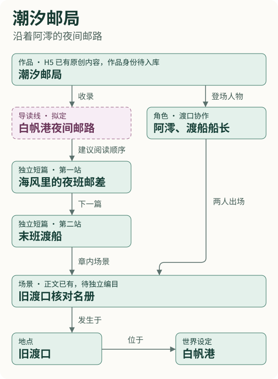
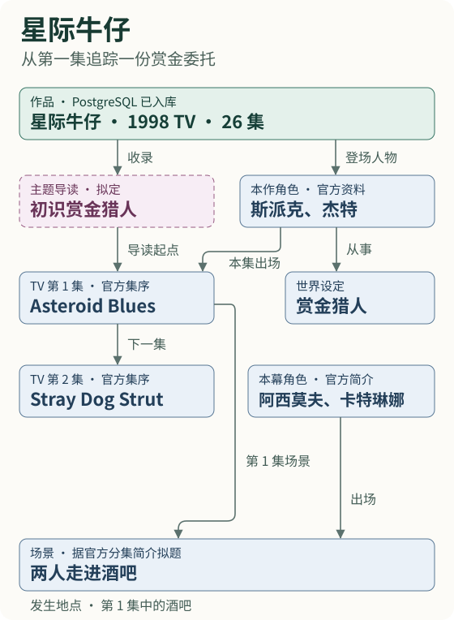

# 从首页进入作品世界

> 历史设计与评审记录。文中的实现状态对应当时样板；当前入口、数据来源与验收范围见[功能地图](../功能地图.md)和[实现核验](../架构实现核验.md)。

**产品设计评审稿 · 潮汐邮局 / 星际牛仔**

建议保留「发现」首页。读者可以直接读首页推荐的那封信，也可以点作品名进入一整个世界。作品世界复用首页的阅读节奏：先给一个值得进入的故事，再让人物、章节、场景和设定相互引路。两个样板共用这套关系，各自决定栏目名和阅读顺序。

## 01　两个作品，走出两条可读路径

### 潮汐邮局：沿着阿澪的夜间邮路

绿色表示在当前原创目录或角色页能找到内容依据；紫色虚线表示这次提出的编排。图中的实体关系均为待落库设计。当前按「潮汐邮局」查询本地作品库未命中，站点品牌和这部原创作品需要分配独立身份。原创记录由平台维护，后续上游快照撤回作品时也应保留。

**读者路径**：从阿澪的角色页打开《末班渡船》，读到船长核对名册和阿澪系鞋带的一幕，点「旧渡口」看地点条目，再沿「发生在这里」回到这一章。现在已有正文、角色、地点名称和试玩文本。拟定的场景标题「旧渡口核对名册」来自公开正文；试玩分支中发现儿童票存根只属于该次互动。

「白帆港夜间邮路」是建议的导读线。可以把《海风里的夜班邮差》列作认识阿澪的第一站，《末班渡船》列作认识船长的第二站；两篇各是独立短篇。这个顺序不宣称两封信的事件在剧情上连续。现有角色页的邮路还可延伸至邮局分拣室、北岬灯塔和守塔人。

### 星际牛仔：从第一集进入一份赏金委托

绿色是本地 PostgreSQL 已有作品记录；蓝色代表官方角色或分集资料有依据、仍待结构化的内容；紫色虚线是站内拟定专题。图中并列的人名仅为便于阅读，入库时每人各有独立角色记录。

**读者路径**：进入 1998 年 TV 版，点斯派克，在「出场章节」进入第 1 集，再读阿西莫夫与卡特琳娜前往酒吧的一幕。点「本幕人物」应看到两位当事人；斯派克和杰特在本集追捕目标，单凭这一点不能把他们列为这幕的目击者。展开「赏金猎人」词条，可反查相关人物与涉及这一职业的章节。首屏导读只介绍委托起点，涉及结局的正文放入本集剧透范围。

本地 UUID 为 `31bc5bf8-4691-493e-8b11-6524a7ef0fa9`。本次查询返回 TV、1998 年、26 集、33 条标题记录、两个上游来源的溯源信息，简介为空。「26 集」只够显示作品规格。第 1、2 集的标题、出场和场景需要逐条补证。官网分集简介支持上述酒吧事件；场景名与「初识赏金猎人」均为站内拟题。角色图、海报和剧照需要各自的使用依据。[本地作品详情](http://127.0.0.1:4310/knowledge/31bc5bf8-4691-493e-8b11-6524a7ef0fa9) · [官方分集资料](https://www.cowboy-bebop.net/story/) · [官方人物资料](https://www.cowboy-bebop.net/character/)

## 02　同一套关系怎样支持两种作品

| 对象 | 归属与关系 | H5 可以回答的问题 |
| --- | --- | --- |
| 作品 | 一条稳定作品 ID 对应一个明确版本。潮汐邮局新增原创身份；星际牛仔复用 TV 版已有 UUID。剧场版单独关联 | 我打开的是哪一部、哪一版？ |
| 角色 | 人物身份与「该角色在本作中的设定」分别保存。关系双方都指向人物，带作品范围、出处和剧透范围 | 她和谁有关系？在哪一章、哪一幕可以看到？ |
| 故事线 | 一个作品可有多条线，一章可属于多条线。成员关系保存阅读顺序和入选理由；区分原作剧情线与站内主题导读 | 第一次看从哪开始？想追某个人应接着读哪篇？ |
| 集／章 | 一集或一篇独立短篇归属一个作品。TV 记官方集序，原创短篇允许无编号；读本身的顺序与专题推荐顺序独立 | 我正在读哪一集或哪篇故事？下一集读什么？ |
| 场景 | 一幕定位到一集／章和具体出处，可列多位出场人物及相关设定。同章可以有多幕，记录幕序及一句无剧透导语 | 这里发生了什么、谁在场、从哪里回原文？ |
| 世界设定 | 地点、组织、载具、世界规则等归属作品，可关联人物、集／章、场景；地点允许上下级 | 旧渡口在哪里？还有哪些故事在这里发生？ |

**数据服务要生产三种可交付的数据。** 第一种是有证据的事实与关系，记录作品版本、来源或原文章节、剧透边界。第二种是供阅读的内容版本，如一句角色导读、一篇章节介绍、一段场景解读，分别标出原创、原作资料或站内解读。第三种是页面编排，保存模块、目标作品、推荐对象、顺序和展示理由。编排引用实体 ID；同一章出现在首页、角色页和故事线时共用正文与出处。

**自动补齐的边界。** 数据服务先把现有原创目录映射到自有作品，再给外部作品挂接可核验资料。候选关系带出处，可用规则确认的进入公开投影；有歧义的关系继续待补，保留上次可用版本。图片按作品、角色、用途和授权状态选用。缺封面就用中性排版，缺场景就隐藏该栏，缺人物资料不生成空人物卡。私人剧情选择、阅读进度不回写为作品事实。

## 03　首页逐块取数

| 当前模块 | 现在从哪里来 | 潮汐邮局 / 星际牛仔的目标效果 | 数据服务要补齐 |
| --- | --- | --- | --- |
| 本期精选 Hero | 本地目录固定三篇轮播，首张另用夜班邮差插画；按钮直达故事 | 主按钮继续「阅读故事／从第 1 集读起」，旁边显示可点击的「潮汐邮局／星际牛仔」作品名 | 首页精选位 → 作品 ID + 文章或章节 ID；无剧透导语、已批准主视觉、手机焦点。轮播每一项用自己的所属作品 |
| 港口人物 | 本地三人数组。阿澪有详情页，船长、守塔人链接到阿澪页内锚点 | 原创显示「港口人物」；TV 版可显示「贝博普号船员」，人物可反查出场，不把全剧角色提前列入第 1 集 | 作品内角色设定、人物关系、出场依据、剧透范围、已批准头像。中文船名遵循选定译名并保留别名 |
| 继续阅读 | 浏览器保存上次故事 slug 和进度；没有记录时不显示 | 返回《末班渡船》上次读到的位置，或返回 TV 第 1 集的站内导读 | 数据服务提供稳定章节与已发布内容版本的映射；浏览器继续保存作品、章、位置。正文改版无法对齐位置时回章节起点 |
| 故事来信 | 本地故事数组前两篇；「全部故事」进入全站故事列表 | 原创展示短篇与手记；TV 展示可读分集导读与专题「初识赏金猎人」 | 集／章目录、可读正文、专题成员与顺序。作品世界的「全部」默认只看本作品；站点首页允许跨作品编排 |
| 剧情片段 | 从两篇本地故事取场景，链接为故事页加 scene 锚点 | 从「旧渡口核对名册」或「两人走进酒吧」进入具体一幕，再回到所属章 | 场景独立 ID、幕序、参与角色、位置、剧透阈值。未发布独立页时，可继续落到原文章内锚点 |
| 探索白帆港／世界观 | 地点名取自故事的 location；地点卡实际打开故事。同区「作品知识库」现已链接 /knowledge | 点旧渡口看到地点及相关章节；点「赏金猎人」看到设定与关联角色；「探索全部作品」进入全站目录 | 设定实体、类型、双向关系、资料出处与内容版本；目录返回资料齐备程度和公开的作品世界链接 |

当前实现依据：[首页与故事阅读页](../../apps/web/src/features/post/editorial.tsx) · [原创内容目录](../../apps/web/src/features/post/catalog.ts) · [人物和卡片跳转](../../apps/web/src/features/post/design.tsx) · [阅读进度](../../apps/web/src/features/post/progress.tsx)

## 04　首页怎么进入作品世界

**从推荐进入。** 首页 Hero 以故事吸引读者，主按钮继续直达故事；作品名成为第二入口。例如「本期精选 · 潮汐邮局」中的作品名打开建议路径 `/work/tidepost`。若这一期主推 TV 第 1 集，作品名相应变为「星际牛仔」，打开 `/work/cowboy-bebop-tv`。首页其他模块若以某一作品为主题，同一区块标题和条目应使用同一个作品上下文，避免在「港口人物」下混入另一部作品的角色。

**从搜索进入。** 建议在「发现」首屏提供常驻「探索作品」，沿用现有 `/knowledge` 目录和别名搜索；页面底部保留现有知识库入口。搜索「星际牛仔」「Cowboy Bebop」应找到同一 TV 版。有已发布世界的结果打开作品世界，保留「查看资料与来源」到原 UUID 详情；只有元数据的结果仍打开资料页。移动端保留现有底部导航。

**从深页返回。** 每个可读节点显示可点击的作品名。例如「潮汐邮局 › 末班渡船 › 旧渡口核对名册」，或「星际牛仔 · TV › 第 1 集 › 两人走进酒吧」。保留现有 `/character/mio`、`/story/last-ferry` 等可阅读地址，通过作品关联补齐回链。上面的两条 /work 地址均为提案。

## 05　样板验收

- **原创迁移**：同一篇《末班渡船》从 Hero、阿澪页、夜间邮路和旧渡口打开时指向同一内容版本。能从具体场景返回原章和作品首页。试玩选择不同，公开作品关系仍一致。
- **外部作品补齐**：用中英文别名找到同一 TV 版；先读第 1 集导语，再看场景出处与本幕人物。站内专题顺序、官方集序和剧透范围可分辨。来源未证实的关系不出现在公开页。
- **降级**：撤去授权图片后文字路径仍可用；只有元数据的作品仍可搜索。无需先为全库逐部补齐，先让这两个作品的阅读闭环成立。
