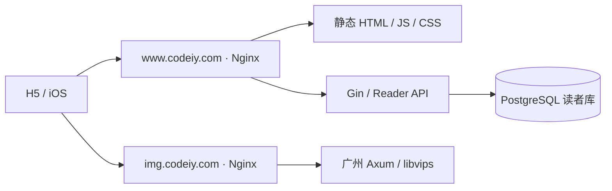

# 网络拓扑与部署边界

## 公网读者入口

`www.codeiy.com` 和 `img.codeiy.com` 由同一个独立 Nginx 提供 HTTPS。一次生产构建生成 `apps/web/dist/site`。基于 React 和 TanStack Router 的 SPA 在浏览器运行，页面、脚本和样式直接从站点目录读取。站点按白名单中继同源 Gin 查询，微信登录、iOS、支付通知和 sitemap 由 Reader API 处理。工作台仍在本地 Vite 与 TanStack Start 开发环境运行。[入口配置](../deploy/gateway/nginx/nginx.conf) · [部署手册](../deploy/gateway/README.md)



所有公开业务图片使用图片域名。广州在原件和变换响应中设置缓存、Content-Type、Range 与 ETag。Nginx 按完整 URL 缓存公开响应，私有图通过 UUID 与短时签名读取。图片上传、资产管理和签发在广州私网。PostgreSQL 保有作品发布指针，SQLite 目录保存图片资产，内容 SHA-256 对应原始字节。[图片库架构](图片库架构.md)

## 网络与数据角色

| 来源 → 目标 | 边界 |
| --- | --- |
| 读者、移动客户端、支付通知 → Nginx | 两个注册域名使用受信 TLS 证书。端口和网络按网关配置 |
| Nginx → Gin、Reader API、广州图片服务 | 独立私网端点。Mesh 方案以节点源 /32 限制三个侦听端口。图片域只代理读图及就绪接口 |
| Reader API → Gin | 内部 HTTP。限读者业务、回调和原生阅读。读者 Cookie 经过服务端校验并转为 Bearer |
| Gin、发布接收器 → PostgreSQL 读者库 | 独立读者与发布身份。账户、订单、定稿和回执随正式读者库管理 |
| 发布接收器 → 广州图片库 | 上传并校验定稿中的入选原件，正文发布事务随后提交 |
| 广州 sync → 制作库及 Pi Durable | 生产规划、文本、用量和验收分别按所属身份访问，Pi SQLite 用于恢复执行 |
| 硅谷 → 制作库、发布接收端 | 受限任务角色及 SSH 投递。模型中继可使用专用 mTLS 身份 |
| 局域网 K3s → 广州备份端点 | 只读导出与独立恢复，已登记源 /32 和独立密钥 |

Mesh 在独立 Docker 网络命名空间运行。杭州使用专用 socket 或经审核的私网端点，广州 listener 通过专用网桥访问 reader-api、Gin 和 image。单次切换前检查端口分配、源地址、DNS 与防火墙。前端切换无需重新建立数据库或更改定稿。涉及跨节点数据库迁移时，先暂停发布与写入、等待在途事务结束、核对业务指针与回执，再接管同一个权威写端。[Mesh 配置](../deploy/gateway/mesh/README.md) · [广州服务](../deploy/guangzhou/README.md)

## 构建与验收

```sh
npm ci
npm run check
deploy/gateway/tests/smoke.sh
```

仓库工作流打包静态目录，并在隔离容器中验证 TLS、SPA 路由、API、图片变换与缓存。实际切换前导入和核对全部在用图像，并配置两个域名、TLS 和广州私网端点。开站后验证移动端的场景回跳、微信与支付通知、现有 iOS 发行渠道及图片响应。公开 HTML 为 SPA 入口，阅读正文和 JSON-LD 在客户端路由加载后生成，sitemap 保持服务端生成。

## 备份与监测

K3s PostgreSQL 备份使用受限导出权限和独立恢复库。备份每天北京时间 03:15 触发，保留七份验证成功的归档。广州图片目录与原件由一致性备份包恢复，衍生缓存可重建。绘制现有节点的运行分布与目标业务归属分别见[部署图](diagrams/deployment.svg)及[目标部署图](diagrams/target-deployment.svg)。[PostgreSQL 备份](../deploy/pg-backup/README.md) · [图片库备份](../apps/image/README.md)

网关访问日志保留状态、缓存命中和上游耗时。以同一作品、同一 API 请求和同一图片分别测量首字节、总耗时与错误率，记录公网和源站样本、缓存冷热、时间与版本。生产测量采用上线后真实流量。
